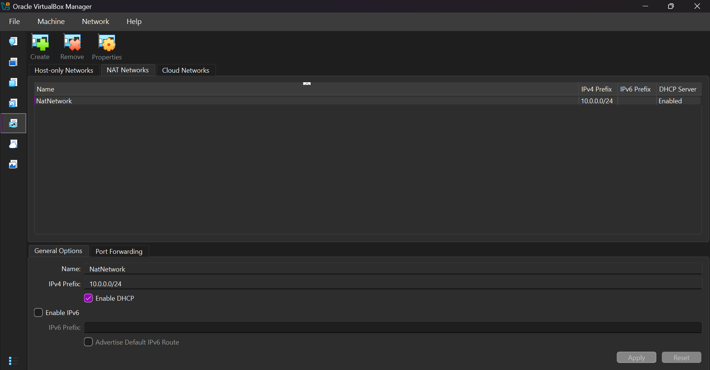
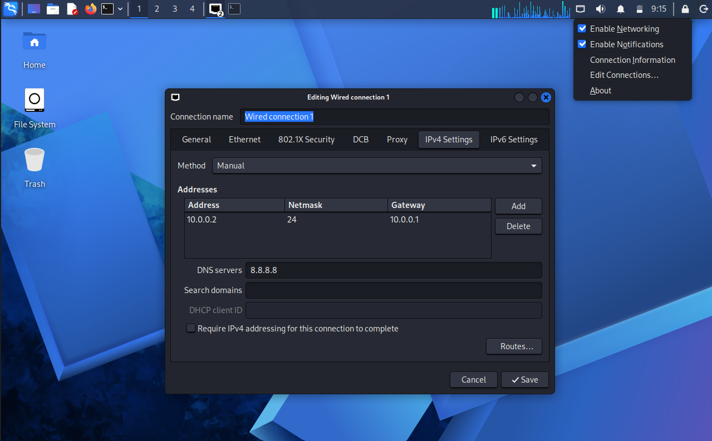
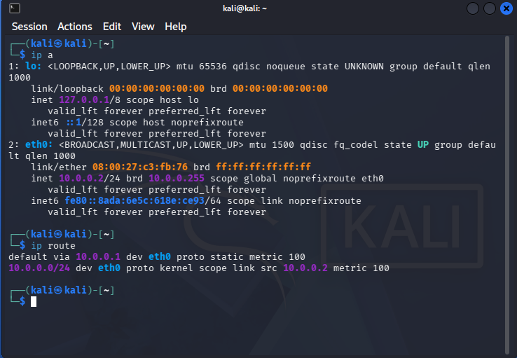

# Cybersecurity Lab Setup – Week 1

## Project Overview

This project was completed as part of my Week 1 cybersecurity internship project at **Networkwalks**.

The objective was to set up a virtual cybersecurity testing lab using Oracle VirtualBox and Kali Linux, establishing a dedicated NAT Network for lab connectivity.

## Tools & Technologies

- Oracle VirtualBox
- Kali Linux
- VirtualBox NAT Network
- NetworkManager

## Lab Environment

| Component | Configuration |
|---|---|
| Virtualization Platform | Oracle VirtualBox |
| Attacking Machine | Kali Linux |
| Network Type | NAT Network |
| Network Name | NatNetwork |
| Network Subnet | 10.0.0.0/24 |
| Kali Linux IP Address | 10.0.0.2/24 |
| Default Gateway | 10.0.0.1 |
| DNS Server | 8.8.8.8 |

## Implementation

The lab environment was configured through the following steps:

1. Created a NAT Network in VirtualBox using the `10.0.0.0/24` subnet.
2. Set up a Kali Linux virtual machine as the attacking machine.
3. Connected the virtual machine to the configured NAT Network.
4. Assigned a static IPv4 address of `10.0.0.2/24` to the Kali Linux network interface.
5. Configured the default gateway and DNS server.
6. Enabled bidirectional shared clipboard and drag-and-drop functionality.
7. Configured a shared folder between the host machine and Kali Linux.
8. Created a snapshot of the configured virtual machine.

## Screenshots

### 1. VirtualBox NAT Network Configuration



### 2. Kali Linux Virtual Machine


### 3. Kali Linux Network Settings



### 4. Network Configuration Verification



## Challenges & Troubleshooting

During static IP configuration, the network connection initially failed to activate due to an IP configuration reservation issue.

This was resolved by setting the IPv4 Duplicate Address Detection (DAD) timeout to zero using NetworkManager:

```bash
sudo nmcli connection modify "Wired connection 1" ipv4.dad-timeout 0
```

The connection was subsequently activated with the intended static IP configuration.

## Learning Outcomes

- Gained hands-on experience configuring virtual machines using VirtualBox.
- Learned to create and configure a NAT Network.
- Practised static IPv4 addressing and network configuration in Kali Linux.
- Gained experience troubleshooting network configuration issues.
- Established a foundation for future cybersecurity testing activities.

---

**Internship:** Networkwalks  
**Project:** WK1-PM1 – Cybersecurity Lab Setup
